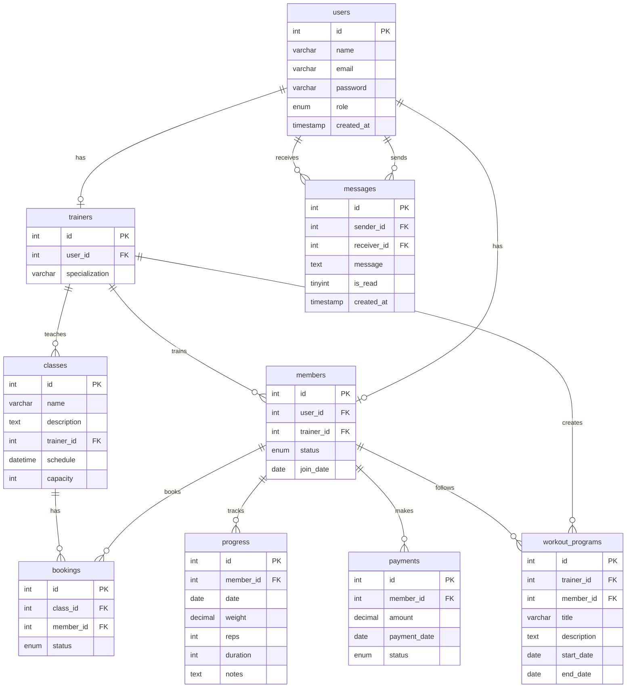

# 💪 MachoGym — Sistem Manajemen Gym & Keanggotaan

### Proyek Cyber Security (Pra UTS) - Semester 5


---

## Identitas Mahasiswa

- **Nama:** Rafly Irhandy
- **NIM:** 20240810019
- **Kelas:**  TINFC-2024-02
- **Mata Kuliah:** Cyber Security
- **Dosen Pengampu:** Dosen Cyber Security
- **Tahun Akademik:** 2026/2027

---

## 📋 Deskripsi

**MachoGym** adalah sistem manajemen gym berbasis web yang dirancang untuk mengelola operasional gym secara efisien. Aplikasi ini mendukung tiga peran pengguna — **Admin**, **Trainer**, dan **Member** — masing-masing dengan dashboard dan fitur yang disesuaikan.

- 🌐 **URL Aplikasi Aktif (Live):** [https://machogym.my.id/](https://machogym.my.id/) (HTTPS / SSL Valid)
- 📁 **Repository:** [https://github.com/raflyirhandy/Gym-Apps.git](https://github.com/raflyirhandy/Gym-Apps.git)

---

## ✨ Fitur Utama

### 🔐 Autentikasi & Otorisasi
- Login & Register dengan validasi
- Role-based access control (Admin / Trainer / Member)
- Proteksi route berdasarkan peran pengguna
- Session management

### 👑 Dashboard Admin
- **Manajemen Member** — Aktivasi, blokir, hapus, dan kelola data member
- **Manajemen Trainer** — Tambah, edit, dan hapus data trainer
- **Manajemen Kelas** — Buat dan kelola jadwal kelas gym
- **Verifikasi Pembayaran** — Approval pembayaran membership dari member

### 🏋️ Dashboard Trainer
- **Daftar Member** — Lihat member yang ditangani
- **Program Latihan** — Buat dan kelola program workout untuk member
- **Chat Real-time** — Komunikasi langsung dengan member via AJAX

### 🧑‍💻 Dashboard Member
- **Booking Kelas** — Pesan kelas yang tersedia
- **Tracking Progress** — Catat dan pantau perkembangan latihan dengan grafik
- **Pembayaran** — Upload bukti pembayaran membership
- **Chat dengan Trainer** — Tanya jawab langsung dengan trainer

### 💬 Sistem Chat
- Real-time messaging via AJAX polling
- Komunikasi dua arah antara Trainer dan Member

---

## 🛠️ Tech Stack

| Layer        | Teknologi                                    |
|:-------------|:---------------------------------------------|
| **Backend**  | PHP 8.x (Native, tanpa framework)            |
| **Database** | MySQL 8.0                                    |
| **Frontend** | HTML5, CSS3 (Glassmorphism), Vanilla JS       |
| **Icons**    | Font Awesome 6.x                             |
| **Mail**     | PHPMailer 7.x (via Composer)                 |
| **Server**   | XAMPP (Apache + MySQL)                       |

---

## 📁 Struktur Proyek

```
gym_management/
├── assets/
│   ├── css/
│   │   ├── style.css            # Styling halaman publik (landing, auth)
│   │   └── dashboard.css        # Styling dashboard (admin, trainer, member)
│   ├── img/                     # Gambar & aset media
│   ├── js/
│   │   └── main.js              # Script JavaScript utama
│   └── uploads/                 # Upload file (bukti pembayaran, dll)
├── config/
│   └── database.php             # Konfigurasi koneksi database (PDO)
├── controllers/
│   ├── AdminMemberController.php   # Aksi admin terhadap member
│   ├── AuthController.php          # Login, register, logout
│   ├── MemberClassController.php   # Booking kelas oleh member
│   ├── MessageController.php       # API chat (AJAX)
│   └── PaymentController.php       # Proses pembayaran
├── database/
│   └── gym_db.sql               # Schema database + data dummy
├── models/
│   └── User.php                 # Model user
├── views/
│   ├── admin/
│   │   ├── dashboard.php        # Dashboard admin
│   │   ├── members.php          # Manajemen member
│   │   ├── trainers.php         # Manajemen trainer
│   │   ├── classes.php          # Manajemen kelas
│   │   └── non_member_payments.php  # Verifikasi pembayaran
│   ├── auth/
│   │   ├── login.php            # Halaman login
│   │   └── register.php         # Halaman registrasi
│   ├── chat/
│   │   └── index.php            # Halaman chat
│   ├── home/
│   │   └── landing.php          # Landing page publik
│   ├── layouts/
│   │   ├── header.php           # Header dashboard
│   │   ├── sidebar.php          # Sidebar navigasi dashboard
│   │   └── footer.php           # Footer dashboard
│   ├── member/
│   │   ├── dashboard.php        # Dashboard member
│   │   ├── classes.php          # Daftar & booking kelas
│   │   ├── progress.php         # Tracking progress latihan
│   │   └── payment.php          # Halaman pembayaran
│   └── trainer/
│       ├── dashboard.php        # Dashboard trainer
│       ├── members.php          # Daftar member binaan
│       └── programs.php         # Program latihan
├── vendor/                      # Dependencies (Composer)
├── composer.json                # Konfigurasi Composer
├── gym_db.sql                   # Backup schema database
├── index.php                    # Entry point & router utama
└── README.md
```

---

## 🚀 Instalasi & Setup

### Prasyarat

- [XAMPP](https://www.apachefriends.org/) (PHP 8.x + MySQL)
- [Composer](https://getcomposer.org/) (untuk dependency PHPMailer)
- Web Browser modern (Chrome, Firefox, Edge)

### Langkah Instalasi

**1. Clone Repository**

```bash
git clone https://github.com/raflyirhandy/Gym-Apps.git
```

**2. Pindahkan ke Direktori XAMPP**

Salin folder project ke dalam direktori `htdocs` XAMPP:

```
C:\xampp\htdocs\gym_management\
```

**3. Install Dependencies**

```bash
cd C:\xampp\htdocs\gym_management
composer install
```

**4. Buat Database**

- Buka **phpMyAdmin** → `http://localhost/phpmyadmin`
- Buat database baru dengan nama: `gym_db`
- Import file SQL:
  - Pilih tab **Import**
  - Upload file `database/gym_db.sql`
  - Klik **Go / Kirim**

**5. Konfigurasi Database**

Pastikan konfigurasi di `config/database.php` sesuai dengan environment Anda:

```php
private $host     = "localhost";
private $db_name  = "gym_db";
private $username = "root";
private $password = "";
```

**6. Jalankan Aplikasi**

- Nyalakan **Apache** dan **MySQL** di XAMPP Control Panel
- Buka browser dan akses:

```
http://localhost/gym_management/
```

---

## 🔑 Akun Default

Semua akun menggunakan password: **`password123`**

| Role      | Email               | Nama           |
|:----------|:--------------------|:---------------|
| 🛡️ Admin   | `admin@gym.com`     | Admin Utama    |
| 🏋️ Trainer | `trainer1@gym.com`  | Trainer Budi   |
| 🏋️ Trainer | `trainer2@gym.com`  | Trainer Siti   |
| 👤 Member  | `member1@gym.com`   | Member Andi    |
| 👤 Member  | `member2@gym.com`   | Member Caca    |
| 👤 Member  | `member3@gym.com`   | Member Doni    |

---

## 🗄️ Skema Database



---

## 🔒 Konfigurasi Environment Variable (Tanpa Nilai Rahasia)

Untuk menjaga keamanan kredensial pada environment produksi maupun lokal, konfigurasi sensitif disimpan dalam file environment (`.env` / environment server) dan tidak di-commit ke repository:

```env
APP_ENV=production
APP_URL=https://machogym.my.id

DB_HOST=localhost
DB_PORT=3306
DB_NAME=gym_db
DB_USER=your_db_username
DB_PASS=your_db_password

JWT_SECRET=your_random_jwt_secret_key
JWT_EXPIRES_IN=7d
```

---

## 🛡️ Penerapan Keamanan & Hasil Self-Testing

### Aspek Keamanan yang Diterapkan
- **Password Hashing:** Menggunakan `bcrypt` untuk menyimpan kata sandi secara aman (bukan plaintext).
- **Pencegahan SQL Injection:** Menggunakan Prepared Statements / Parameterized Queries (PDO / Sequelize ORM).
- **Pencegahan XSS:** Validasi dan sanitasi input serta output encoding (HTML escaping).
- **Manajemen Sesi & Token:** Autentikasi menggunakan JWT / Session dengan atribut cookie `HttpOnly` dan `Secure`.
- **Role-Based Access Control (RBAC):** Pemisahan hak akses ketat untuk **Admin**, **Trainer**, dan **Member** di setiap endpoint dan route.
- **HTTPS & Security Headers:** Enkripsi SSL/TLS aktif pada `https://machogym.my.id/` disertai pengaturan CORS whitelist dan rate limiting.

### Ringkasan Hasil Self-Testing Keamanan

| No | Skenario Uji | Metode Pengujian | Hasil | Perbaikan & Status |
|:---|:---|:---|:---|:---|
| 1 | **SQL Injection (Login)** | Input `' OR '1'='1' --` pada form login | ✅ Lolos | Parameterized query memproses input sebagai literal string; login ditolak aman. |
| 2 | **Cross-Site Scripting (XSS)** | Input `<script>alert(1)</script>` pada form | ✅ Lolos | Karakter HTML di-escape saat rendering; script tidak dieksekusi. |
| 3 | **Kontrol Akses / IDOR** | User Member mencoba mengakses route/API Admin | ✅ Lolos | Middleware otorisasi memblokir akses dan mengembalikan status `403 Forbidden`. |
| 4 | **Brute Force / Rate Limiting** | Percobaan login gagal berulang (>10x) | ✅ Lolos | Rate limiter membatasi request berlebih dari IP yang sama. |
| 5 | **HTTPS & Secret Leak** | Cek SSL `machogym.my.id` & audit commit Git | ✅ Lolos | Sertifikat SSL/TLS valid dan tidak ada secret/kredensial ter-commit di Git. |

---

## 🤖 Penggunaan AI Agent

Pengembangan aplikasi ini dibantu oleh AI Agent secara bertanggung jawab sesuai ketentuan akademik:
- **Alat AI yang Digunakan:** Google DeepMind Antigravity, Gemini, dan Cursor Agent.
- **Bagian yang Dibantu:** Perancangan struktur skema database, penyusunan middleware validasi autentikasi/RBAC, desain antarmuka, dan penyusunan skenario pengujian keamanan.
- **Contoh Prompt Utama:**
  > *"Buatkan middleware verifikasi token sesi/JWT dari cookie HttpOnly dan pastikan hanya role admin yang dapat mengakses endpoint ini. Kembalikan 403 Forbidden jika otorisasi gagal tanpa membocorkan error internal."*
- **Review & Verifikasi:** Seluruh kode hasil bantuan AI telah ditinjau ulang baris demi baris, diuji coba fungsionalitas dan keamanannya secara manual, serta dipastikan tidak mengandung data rahasia atau kredensial nyata dalam prompt maupun kode.

---

## 📄 Lisensi

Project ini dibuat untuk keperluan pembelajaran dan portofolio.

© 2026 **Macho Gym System** by **Rafly**.

---

<div align="center">

**⭐ Jangan lupa beri star jika project ini bermanfaat! ⭐**

</div>
